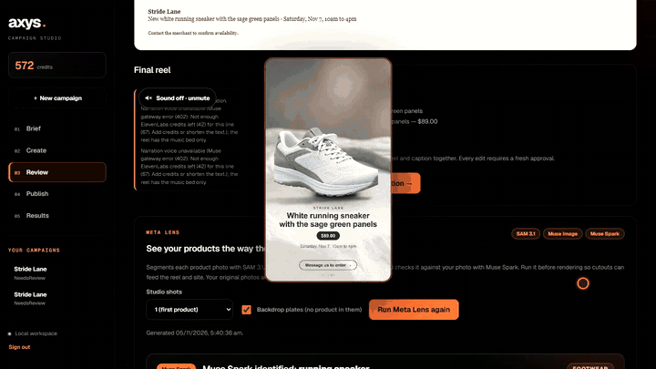
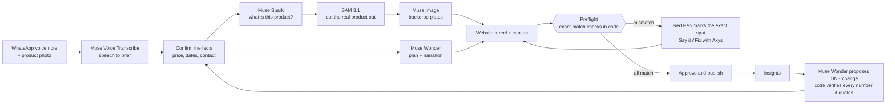
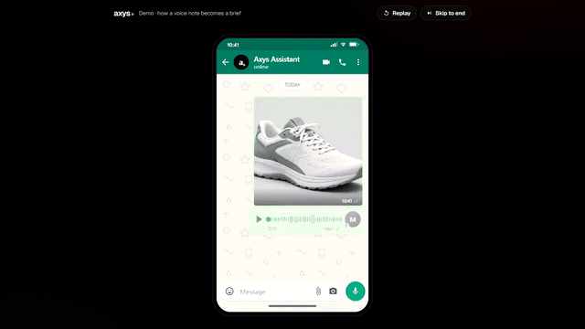
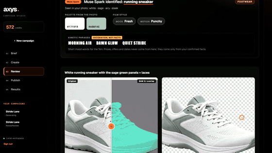
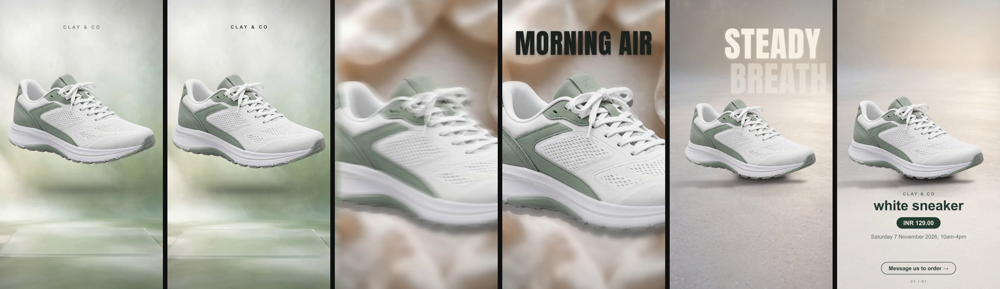
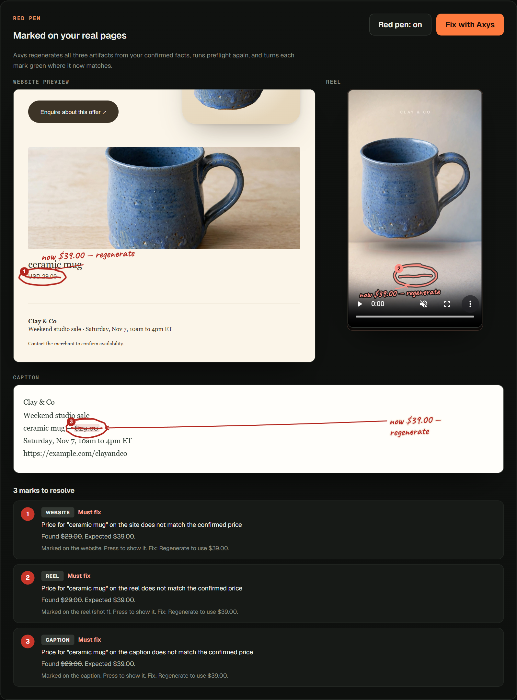
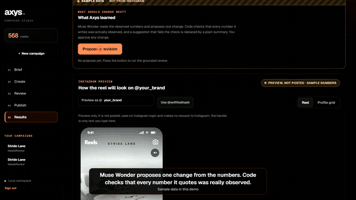
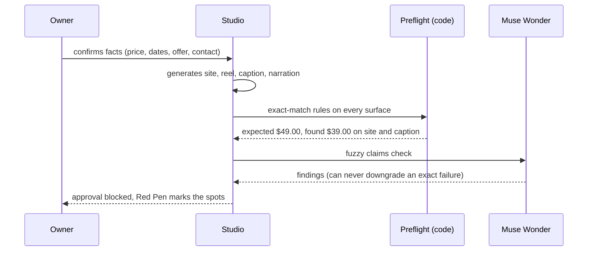
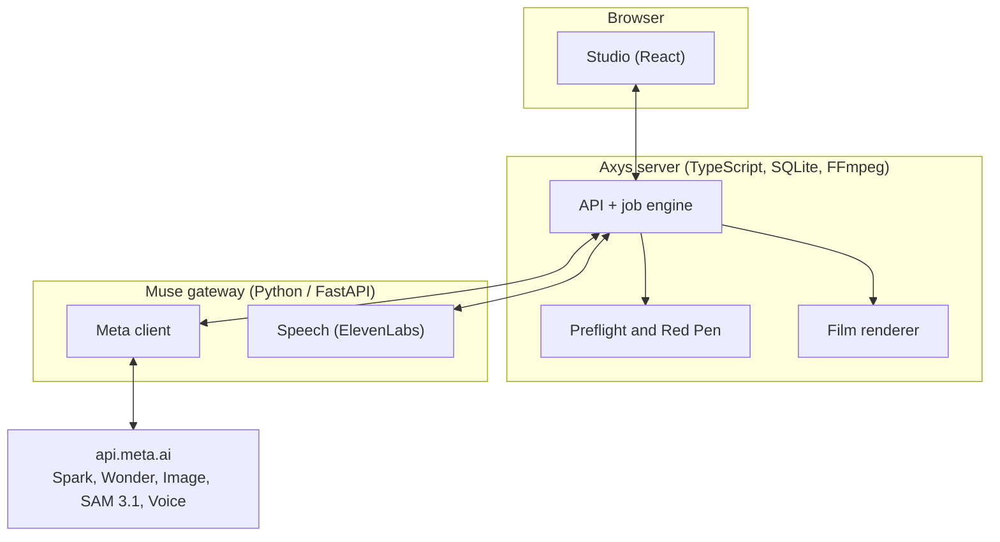

<div align="center">

# Axys for Meta

### A voice note and a product photo in. A launch out, with every price checked by code.

For small business owners and SMEs who have no designer, no editor and no time.

[**Live site**](https://axys-for-meta.onrender.com) · [**Demo video (2:56)**](docs/evidence/demo.mp4) · [How it works](#how-it-works) · [Run it](#run-it)




</div>

---

## The problem

A shop owner can take a photo and say what they are selling. Turning that into a website, a reel and a caption is where the day goes, and AI shortcuts
make a new risk: the model quietly gets a **price, a date or a product wrong**, and the owner finds out after posting.

Axys builds the launch from the owner's **confirmed facts**, then refuses to let anything through until every surface (site, reel text, caption, even the
spoken narration) says exactly the same thing. **Agents propose. Code decides.**

## How it works



Every Meta model has one job whose output feeds the next:

| Meta model | Job in Axys |
|---|---|
| **Muse Voice Transcribe 1.0** | Turns the merchant's voice note into the brief (16 kHz PCM over Meta's realtime socket). Measured word error rate on our test note: 15.6%. |
| **Muse Spark 1.3** | Looks at the photo and names the product, its visible parts, palette and mood, which drive the whole reel. Also powers Meta Lens and Red Pen box location. |
| **SAM 3.1** | Cuts the real product out, including parts (the raspberries on a cake) as one union mask. |
| **Muse Image 1.0** | Paints the backdrop the real product is composited onto. |
| **Muse Wonder 1.0** | Plans the campaign, writes the reel narration, parses spoken changes, runs a fuzzy preflight beside the exact one, and proposes revisions from results. |

Meta's API has no speech-synthesis or video model, so narration is voiced by ElevenLabs behind the gateway. Muse Wonder still writes every word, and the words are validated in code.

### From WhatsApp to Studio

<p align="center"></p>

The owner sends a photo and a voice note. Muse Voice Transcribe turns it into text, the assistant pulls out the facts and asks the owner to confirm them, and the draft continues in Studio.

### A reel that knows what the product is

<p align="center"></p>

The reel is not a template. It uses your real product pixels in a hero shot, a whip-pan, a macro close-up, kinetic type chosen for the product, a context scene and a price-and-date card, with
narration and a music bed. The product is composited, never regenerated, so it cannot morph; fidelity is measured.



### Parts are cut with the product

SAM on "the cake" leaves the raspberries behind; Spark names the visible part and the masks are merged (coverage 19% to 28% on a live run).

### Say it. Red Pen. Fix.

Say "make the sneaker price 99 dollars". Muse Wonder turns it into a strict, code-checked change (every number must come from your words). Axys then **red-pens your actual pages**: a
hand-drawn ellipse on the stale price in the website, on the reel frame and in the caption. Press **Fix with Axys** and every mark turns into a green tick.



### A feedback loop that cannot invent numbers

<p align="center"></p>

After posting, Muse Wonder proposes **one** change. Code then checks that every number in it was really observed, and that it claims no sales or causation. A suggestion that fails is
replaced by a plain summary of the observed numbers (that is what the clip above shows).

## What preflight checks



Prices, dates, offer text, contact details and the spoken narration are compared by exact match. Currency forms are treated as equal (`$129`, `129.00 USD`, `129 dollars`); a different currency blocks.

## Architecture



The gateway is the only process that holds `MODEL_API_KEY`. If it is down or has no key, features fail with a clear message and nothing is faked. An optional Modal deployment of the gateway lives on the `modal-gateway` branch.

## Run it

Requires Node 22+, Python 3.11+ and FFmpeg.

```bash
# 1. gateway (reads MODEL_API_KEY from .env)
python -m venv .venv && .venv/bin/pip install -r gateway/requirements.txt
.venv/bin/python -m uvicorn gateway.server:app --port 8766

# 2. app + Studio (second terminal)
npm ci && npm run build && npm start
```

Open http://127.0.0.1:4310/?studio=1 and use the `local-demo` development login. Windows users: activate the venv with `.venv\Scripts\activate`.

Docker: `docker compose up` runs the gateway, the app and Caddy (HTTPS). A single container for platforms such as Render is the last stage of the `Dockerfile`; see [docs/DEPLOY.md](docs/DEPLOY.md) and `render.yaml`.

Checks: `npm run typecheck && npm test` (232 Node tests) and `python -m pytest -q tests_py` (gateway). Live evidence: `node scripts/live-e2e.mjs`, see [docs/EVIDENCE.md](docs/EVIDENCE.md).

## What was built during the hackathon

The repository starts from **Axys**, a campaign studio built before the hackathon: campaign schema, credit ledger, CRM, WhatsApp intake, Instagram publishing adapters, FFmpeg renderer and the React studio.
`docs/BASELINE.sha256` fingerprints every file as copied, and **[docs/META_NEW.md](docs/META_NEW.md) lists every file added or changed for the hackathon**: the Muse gateway, the Meta-powered planner and preflight,
SAM and Muse Image enrichment, voice intake, the product-aware film, narration and audio, Say it, Red Pen, the feedback loop, the redesigned landing page and Studio.

## Honest status

- **Live against Meta's API:** planning and preflight, SAM cutouts (including parts), Muse Image plates, Spark direction, voice transcription of the demo voice note, narration, Say it commands, Red Pen and Fix, grounded revision proposals.
- **Staged in the demo video:** the WhatsApp conversation, the Instagram view and the insights numbers. The code for connecting an Instagram professional account, publishing a reel and reading insights exists, but has not been run against a real account, and nothing has been posted anywhere.
- **Not verified:** microphone capture in the Studio and the WhatsApp bridge.
- **Known limits:** SAM may miss unusual or very thin products; parts handling covers the first product of a campaign; single-node SQLite; reels are FFmpeg compositions of real product pixels because Meta's API has no video model; the free hosting tier is too small for reliable renders.
